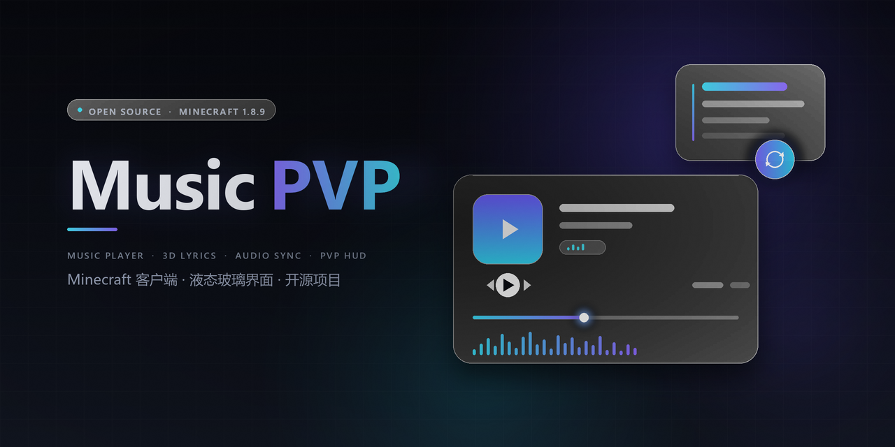
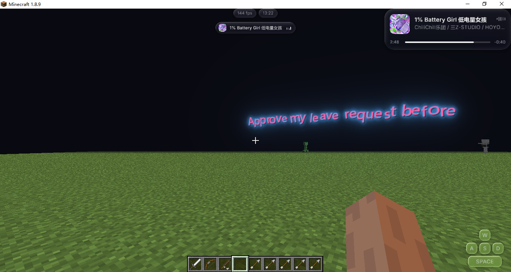
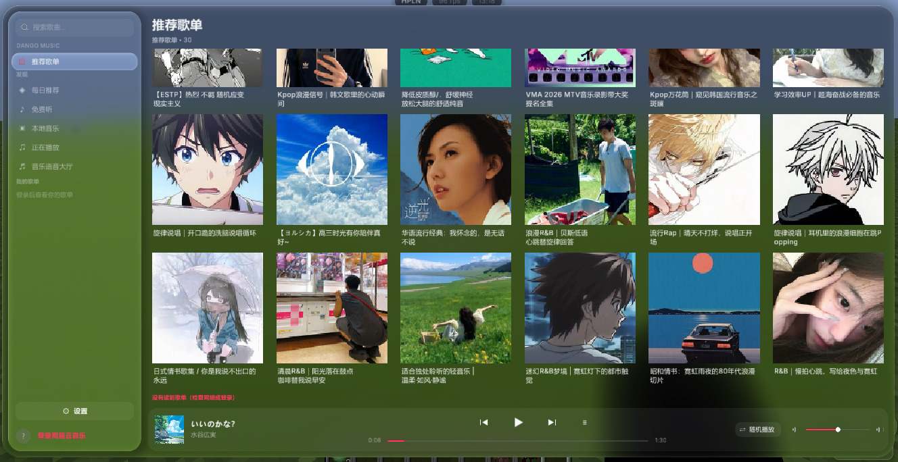
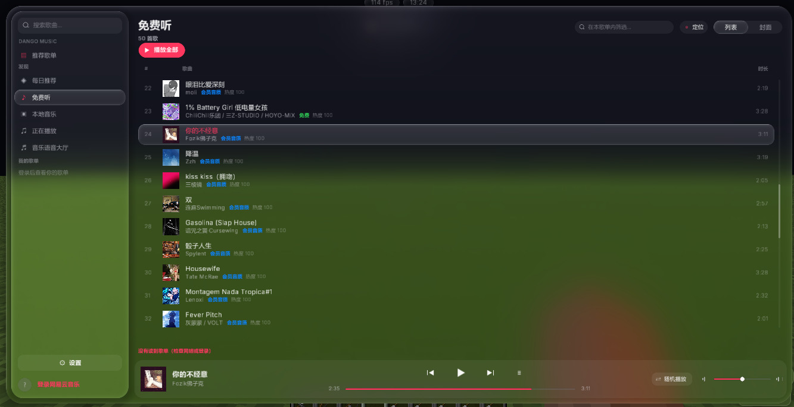
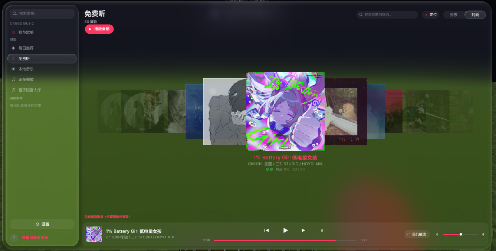
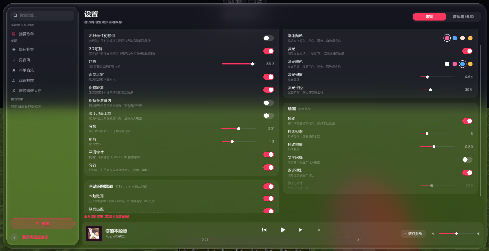
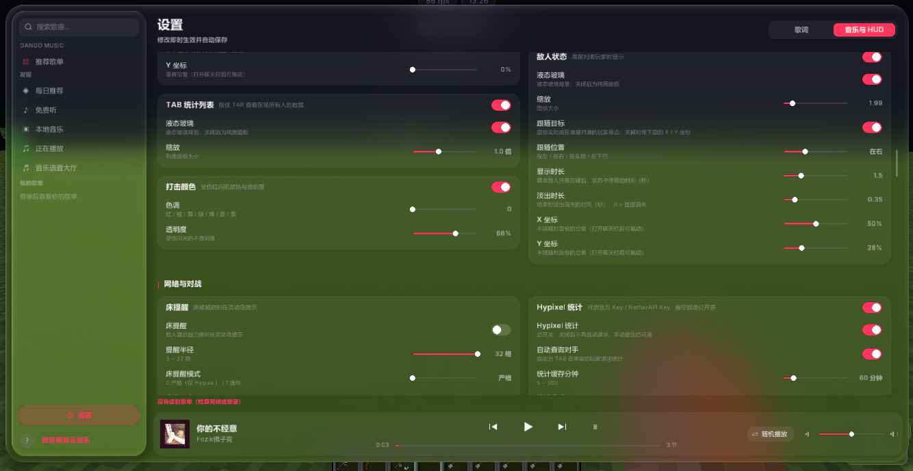

<p align="center"></p>

# Music PVP

**在 Minecraft 里听网易云音乐，也顺手打好 PVP。**

面向 Minecraft 1.8.9 Forge 的液态玻璃风格客户端：网易云播放器、3D 逐字歌词、歌曲卡片、灵动岛，以及开箱即用的音乐语音大厅。

<p align="center">
  <a href="https://github.com/mimistb/Music-PVP/releases"></a>
  
  
  <a href="LICENSE"></a>
</p>

> **30 秒了解**
>
> - **是什么**：把网易云音乐播放器和 PVP 辅助整合进 Minecraft 1.8.9 的 Forge mod。
> - **能解决什么**：打 PVP 时不用切出游戏就能听歌、看歌词；想要好看的 HUD、3D 歌词和“一起听歌”，又不想拼装一堆工具。
> - **如何开始**：下载 jar → 放进 `.minecraft/mods` → 进游戏按 `.` 扫码登录。

**快速导航**：
[项目概述](#项目概述) · [效果展示](#效果展示) · [核心功能](#核心功能) · [快速开始](#快速开始) · [安装](#安装) · [使用说明](#使用说明) · [技术栈](#技术栈) · [贡献指南](#贡献指南) · [许可证](#许可证)

## 项目概述

### 项目定位

Music PVP 是面向 Minecraft 1.8.9 Forge 的客户端 mod。它把网易云音乐的播放、搜索、歌单和逐字歌词带进游戏，同时内置面向 PVP 场景的信息显示、视觉增强和性能选项。

它区别于两类常见方案：只负责播放的音乐 mod，和只堆功能开关的 PVP 客户端。Music PVP 把两者放进同一套液态玻璃界面中——听歌、看歌词、查看对局信息，都在游戏内完成。

### 它解决什么问题

- **打 PVP 时切屏听歌**：播放器直接开在游戏里，不用切到桌面或最小化窗口。
- **界面风格割裂**：播放器、歌词、歌曲卡片和 HUD 统一为液态玻璃视觉，不再拼凑多个不同风格的组件。
- **一起听歌门槛高**：不需要网易云账号、不需要配置任何 Key，一个 5 位房间码就能同步听歌。
- **1.8.9 缺少现代体验**：在低版本 Forge 上提供逐字 3D 歌词、灵动岛、信息胶囊和多项性能优化。

### 差异化亮点

- **一份 mod，两套体验**：音乐播放与 PVP 辅助共用同一套界面、设置和快捷键，不用同时安装多个客户端。
- **桌面级音乐界面**：液态玻璃风格、列表 / 封面墙视图、平滑滚动与切换动画；歌词还能以 3D 形式漂浮在游戏世界中。
- **零配置的一起听歌**：公共 MQTT 中继开箱即用，房主创建房间、分享房间码，其他人输入即可同步到同一首歌、同一秒。
- **为 1.8.9 PVP 场景打磨**：内置战斗、视觉、信息类组件和性能选项，兼容 Forge 1.8.9 及支持 Forge mod 的客户端（如 Lunar）。

## 效果展示

<p align="center"></p>
<p align="center"><sub>漂浮在世界里的 3D 歌词</sub></p>

| | | |
|:---:|:---:|:---:|
|  |  |  |
| 首页 · 推荐歌单 | 歌单 · 列表视图 | 歌单 · 封面墙视图 |

| | |
|:---:|:---:|
|  |  |
| 设置 · Lyrics | 设置 · Music &amp; HUD |

> 以上均为游戏内实际界面；进入游戏后按 `.` 打开播放器即可体验。

## 核心功能

### 网易云音乐播放器

- 默认按 `.` 打开：每日推荐、我的歌单、搜索。
- 列表视图 / 封面墙视图自由切换，歌单内支持筛选和一键定位到正在播放。
- 平滑滚动与切换动画，配合液态玻璃界面。
- 网易云扫码登录；VIP 歌曲需要会员账号。

### 逐字歌词

- 支持网易云逐字歌词（yrc），跟着演唱逐句（逐字）呈现。
- 3D 歌词漂浮在世界里，随演唱出现，暂停时自动隐藏。
- 歌词效果：Deep Glow 发光、Wiggle 抖动、文闪、Word pop。
- 自动拆开“两句写在一行”的歌词。
- 三种歌词显示方式：灵动岛歌词、3D 歌词、2D 歌词栏。

### 歌曲卡片

- iOS 风格的歌曲卡片，显示正在播放的歌曲信息。
- 打开聊天栏后可以拖动卡片位置。
- 在聊天栏点击进度条，可直接调节到点击的进度位置。

### 灵动岛

- 屏幕顶部显示正在播放的内容。
- 切歌或显示灵动岛歌词时自动展开。

### 音乐语音大厅（一起听歌）

- 开房间、分享房间码，所有人自动同步到同一首歌、同一秒。
- 内置语音，公共中继开箱即用；语音时游戏延迟可能略有升高。
- 房间状态只包含歌曲与进度，不涉及网易云账号。

### PVP 辅助与性能

| 类别 | 组件 |
|---|---|
| 战斗辅助 | 自动疾跑、自动 GG、快捷发言、方块高亮 |
| 视觉与视角 | 自由视角、平滑放大、自定义迷雾、火焰遮盖、特效、粒子数量调整 |
| 信息显示 | 信息胶囊（玩家状态）、敌人状态（液态玻璃样式）、CPS 显示、护甲显示、Hypixel 床警报、玩家数据 |
| 聊天 | 聊天增强 |
| 性能 | 多项内置性能优化选项，并持续增加 |

- **信息胶囊**：显示玩家状态信息。
- **敌人状态**：液态玻璃样式的敌人状态显示（持续优化中）。
- **玩家数据**：设置 API 后按 Tab 查看。
- **Hypixel 床警报**：现有 bug 修复中。

### 设置与快捷键

- 所有设置集中在播放器侧栏的 ⚙ 中。
- 可绑定快捷键：播放 / 暂停、上一首、下一首、音量、歌词显示方式（灵动岛 / 3D 歌词 / 2D 歌词栏）。

## 快速开始

| 步骤 | 操作 | 结果 |
|---|---|---|
| 1 | 在 [Releases](https://github.com/mimistb/Music-PVP/releases) 下载适用于 1.8.9 的 jar | 获得 `Music.PVP.x.x.x+1.8.9.jar` 形式的安装包 |
| 2 | 把 jar 放进 `.minecraft/mods` | mod 随游戏启动加载 |
| 3 | 使用 Forge 1.8.9（11.15.1.2318）或支持 Forge mod 的客户端启动游戏 | 进入游戏世界 |
| 4 | 按 `.` 打开播放器，点击左下角扫码登录网易云 | 开始播放每日推荐或自己的歌单 |

接下来可以：

- 在设置 ⚙ 中绑定播放控制快捷键，并选择喜欢的歌词显示方式。
- 打开音乐语音大厅创建房间，把 5 位房间码发给朋友一起听歌。
- 按需开启信息胶囊、敌人状态和 PVP 组件。

## 安装

### 环境要求

| 项目 | 要求 |
|---|---|
| Minecraft | 1.8.9 |
| 加载器 | Forge 1.8.9（11.15.1.2318），或支持 Forge mod 的客户端（如 Lunar） |
| Java | Java 8 |

### 安装步骤

1. 前往 [Releases](https://github.com/mimistb/Music-PVP/releases) 下载最新 1.8.9 版本。
2. 将 jar 放入对应游戏实例的 `.minecraft/mods` 目录。
3. 启动游戏，进入世界后按 `.` 打开播放器。
4. 点击播放器左下角的二维码，用网易云音乐 App 扫码登录。

> VIP 歌曲需要登录网易云会员账号。

### 配置与数据

配置、登录凭证和缓存统一保存在：

```text
.minecraft/config/Music PVP/
```

升级时替换 jar 即可继续使用原有设置与登录状态。

## 使用说明

### 打开与浏览

- 按 `.` 打开 / 关闭播放器。
- 在首页浏览每日推荐，或进入“我的歌单”和搜索页。
- 在歌单内使用列表视图筛选歌曲，或切换到封面墙视图浏览。
- 点击“正在播放”可一键定位到当前歌曲。

### 切换歌词显示方式

在设置 ⚙ 中为“歌词显示方式”绑定快捷键，可在以下三种模式间切换：

- **灵动岛歌词**：在屏幕顶部的灵动岛中显示。
- **3D 歌词**：歌词漂浮在游戏世界中。
- **2D 歌词栏**：以平面歌词栏显示。

3D 歌词会在暂停时自动隐藏，继续播放后重新出现。

### 操作歌曲卡片

- 打开聊天栏后，可拖动歌曲卡片到合适的位置。
- 在聊天栏点击歌曲卡片的进度条，可直接跳转到点击的进度位置。

### 使用音乐语音大厅

1. 在播放器中打开音乐语音大厅，创建房间。
2. 将生成的 5 位房间码发给朋友。
3. 朋友输入同一房间码加入，自动同步到同一首歌、同一秒。
4. 开启语音，一边听歌一边游玩；公共中继开箱即用，语音时游戏延迟可能略有升高。

<details>
<summary>技术细节：公共中继与自建服务器</summary>

- 模组默认连接公共 MQTT 服务器 `broker.emqx.io`，连接失败时自动切换到 `broker.hivemq.com`。
- 房间状态只包含“哪首歌、第几秒、在不在放”和玩家昵称，不涉及网易云账号。
- 房间码是随机的主题名；房主关闭房间时会清空状态，不影响其他房间。
- 断线会自动重连并重新订阅；进度按“收到消息时的本机时间”推算，不要求两台电脑时钟一致。
- 如需换成自己的中转服务器，修改 `common/core/.../party/MqttClient.kt` 中的 `BROKERS` 列表即可。

</details>

### 设置与 PVP 组件

| 想做的事 | 入口 |
|---|---|
| 绑定播放 / 暂停、上一首、下一首、音量、歌词模式 | 播放器侧栏 ⚙ |
| 查看玩家状态 | 信息胶囊 |
| 查看敌人状态 | 液态玻璃敌人状态显示 |
| Hypixel 床警报 | 设置中开启（bug 修复中） |
| 查看玩家数据 | 设置 API 后按 Tab |
| 开关各类 PVP 组件与性能选项 | 播放器侧栏 ⚙ |

### 已知问题

- 敌人状态：持续优化中。
- Hypixel 床警报：现有 bug 修复中。
- CPS 显示：无法分割的 bug 修复中。
- 护甲显示：视觉问题修复中。

遇到其他问题，欢迎在 [Issues](https://github.com/mimistb/Music-PVP/issues) 附上复现步骤与日志反馈。

### 常见问题

**需要网易云会员吗？**

普通歌曲通常不需要会员；VIP 歌曲需要登录会员账号，海外账号播放大部分歌曲也需要会员。

**支持 Fabric、NeoForge 或其他 Minecraft 版本吗？**

当前 Releases 仅提供 Minecraft 1.8.9 Forge 版本。

**Lunar 等客户端可以用吗？**

支持 Forge mod 的客户端（如 Lunar）可以使用。

**一起听歌需要登录网易云或配置 Key 吗？**

不需要。创建房间后分享 5 位房间码即可，模组会自动连接公共中继。

## 技术栈

| 层面 | 技术 |
|---|---|
| 运行平台 | Minecraft 1.8.9 + Forge 11.15.1.2318 |
| 开发语言 | Kotlin 2.0.21、Java 8 |
| 构建工具 | Gradle（Kotlin DSL）、ForgeGradle 2.3、ShadowJar |
| 渲染 | OpenGL 着色器与自定义字体；液态玻璃模糊、Deep Glow、3D 歌词 |
| 音乐 | 网易云音乐非官方接口、逐字歌词（yrc）、JLayer MP3 解码 |
| 联机 | MQTT（`broker.emqx.io`，备用 `broker.hivemq.com`） |
| 其他 | ZXing 二维码登录；Inter、Roboto Slab 字体 |

第三方依赖会随 jar 一起打包并重定位包名，降低与其他 mod 或 Lunar 自带库的类冲突。

### 项目结构（1.8.9 相关）

```text
version.properties   统一版本号
common/core          核心：模块系统、设置、网易云接口、播放器、音乐语音大厅（不依赖 Minecraft）
common/ui            界面：播放器、歌词、歌曲卡片、灵动岛、HUD（通过 Gfx / Platform 接口绘制）
legacy/              1.8.9 Forge 平台层：渲染、字体、入口与打包
docs/                banner 与展示截图
```

`common` 不单独发布，由平台层通过 `includeBuild("../common")` 引入并打进同一个 jar。因为 `common` 不依赖 Minecraft，在共用代码中误用游戏类会直接编译失败。

### 从源码构建

需要 JDK 8。

```bash
cd legacy
gradlew build        # 构建，产物位于 legacy/build/libs/
gradlew runClient    # 在开发环境中启动客户端
```

Windows 下如果 `gradlew` 无法直接执行，使用：

```bat
cd legacy
gradlew.bat build
gradlew.bat runClient
```

## 贡献指南

欢迎提交 Issue 和 Pull Request。

### 反馈问题

- 先搜索现有 [Issues](https://github.com/mimistb/Music-PVP/issues)，避免重复。
- 反馈时请附上：mod 版本、游戏版本、Forge 或 Lunar 环境、复现步骤和相关日志（`.minecraft/logs/latest.log`）。

### 提交代码

1. Fork 仓库并新建分支。
2. 保持改动聚焦：一个 PR 尽量只解决一个问题或实现一个功能。
3. 在 `legacy` 目录执行 `gradlew build`，确认构建通过。
4. 发起 PR，说明改动目的、主要修改点和测试方式；界面相关改动建议附上截图。

### 代码约定

- 核心逻辑放在 `common/core`，界面相关放在 `common/ui`，平台相关实现放在 `legacy`。
- 不要在 `common` 中引用 Minecraft 类，否则会破坏共用层的平台无关性并导致编译失败。
- 不要提交登录凭证、个人配置或构建产物。

## 说明

- 使用的是网易云音乐的非官方接口，仅供个人学习交流；歌曲版权归各平台和版权方所有。
- 海外账号需要会员才能播放大部分歌曲。

## 第三方

- [Inter](https://github.com/rsms/inter)（SIL Open Font License 1.1），[Roboto Slab](https://fonts.google.com/specimen/Roboto+Slab)（Apache License 2.0）
- [JLayer](http://www.javazoom.net/javalayer/javalayer.html)（LGPL）：MP3 解码
- [ZXing](https://github.com/zxing/zxing)（Apache License 2.0）：登录二维码
- Kotlin 标准库（Apache License 2.0）

## 许可证

[GPL-3.0](LICENSE)：可以自由使用、修改和分发；分发修改后的版本时也必须以 GPL-3.0 开源。
